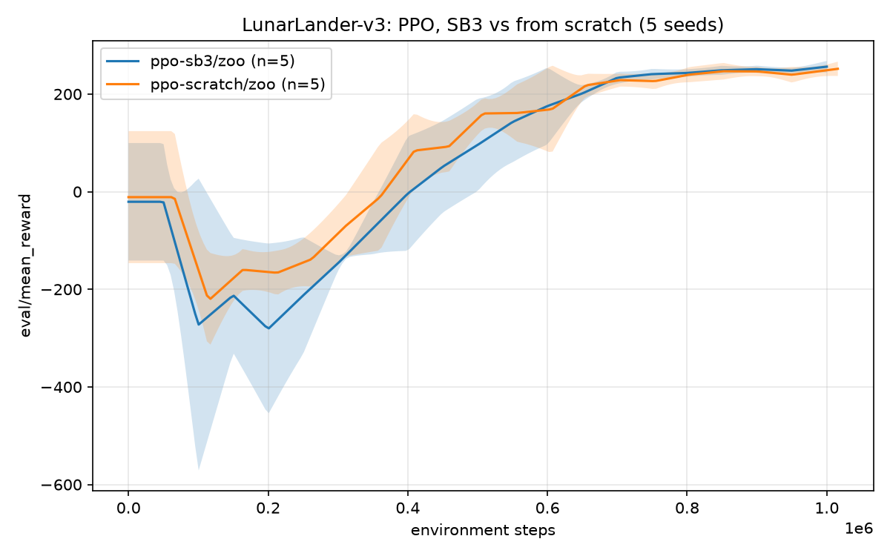
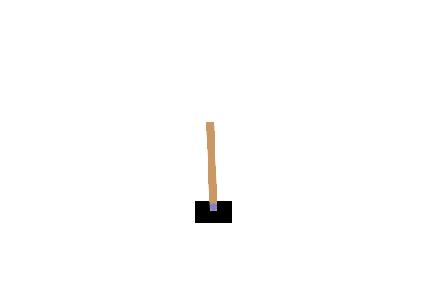
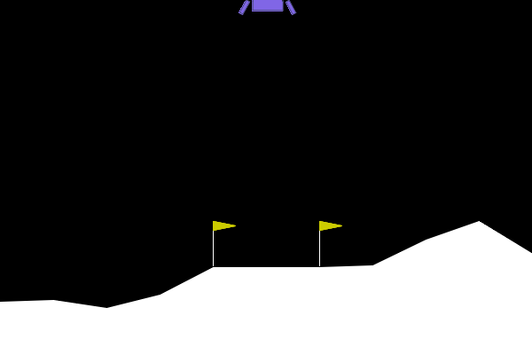

# RLProject

A config-driven reinforcement learning system: Stable Baselines3 and from-scratch DQN/PPO on Gymnasium benchmarks, with a custom **Warehouse robot** environment as the headline problem.

> Work in progress, built phase by phase. See the status table below.

## Status

| Phase | Scope | State |
|---|---|---|
| 0 | Scaffold, tooling, CI | Done |
| 1 | SB3 benchmark pipeline (train / evaluate / record) | Done |
| 2 | From-scratch DQN and PPO | Done |
| 3 | Warehouse-v0 environment and baselines | Planned |
| 4 | Warehouse training and reward engineering | Planned |
| 5 | Experiments, tuning, statistics | Planned |
| 6 | Streamlit dashboard | Planned |
| 7 | Polish | Planned |

## Setup

Requires Python 3.11+ and [uv](https://docs.astral.sh/uv/).

```bash
uv sync                 # installs CUDA 12.8 PyTorch on Windows
uv sync --extra box2d   # adds Box2D for LunarLander
```

## Usage

```bash
# Train from a YAML config; any field can be overridden with --set
uv run rlagent train configs/benchmarks/cartpole_ppo.yaml --seed 0
uv run rlagent train configs/benchmarks/cartpole_dqn.yaml --set train.total_timesteps=20000

# Evaluate and record a finished run
uv run rlagent evaluate runs/CartPole-v1/ppo-sb3/zoo/seed_0 --episodes 100
uv run rlagent record runs/CartPole-v1/ppo-sb3/zoo/seed_0 --out docs/figures/cartpole_ppo.gif

# Overlay learning curves across seeds and compare implementations
uv run rlagent compare runs/CartPole-v1/ppo-sb3/zoo runs/CartPole-v1/ppo-scratch/zoo --out results/cartpole_ppo

# Watch learning curves
uv run tensorboard --logdir runs
```

Each run writes to `runs/<env>/<algo>-<impl>/<name>/seed_<k>/` with the resolved `config.yaml`, `progress.csv`, TensorBoard logs, and the best and final models (with `VecNormalize` statistics when used).

## From-scratch agents (Phase 2)

`rlagent.agents.scratch` holds PPO and DQN written directly in PyTorch (discrete actions, flat observations). They plug into the same `train` / `evaluate` / `record` / `compare` commands as SB3 and log the same metric names, so curves overlay directly. Select them with `impl: scratch` in a config (see `configs/benchmarks/*_scratch.yaml`).

- **PPO:** clipped surrogate, GAE, orthogonal init, per-minibatch advantage normalisation, gradient clipping, LR annealing, KL early stop, time-limit bootstrapping.
- **DQN:** target network, Huber loss, gradient clipping, optional Double DQN (on by default, so it differs slightly from SB3's vanilla DQN), time-limit truncations stored as non-terminal.

## Benchmark results (Phases 1-2)

Hyperparameters start from the RL Baselines3 Zoo and are identical for SB3 and scratch. Scores are the **best checkpoint** (chosen by periodic 10-episode evals), re-evaluated on 100 fresh episodes with deterministic actions, then summarised over 5 seeds. IQM is the interquartile mean.

| Env | Algo | SB3 mean ± std (IQM) | Scratch mean ± std (IQM) |
|---|---|---|---|
| CartPole-v1 | PPO (100k steps) | 500.0 ± 0.1 (500.0) | 499.9 ± 0.3 (500.0) |
| CartPole-v1 | DQN (50k steps) | 497.0 ± 6.0 (500.0) | 499.9 ± 0.1 (500.0) |
| LunarLander-v3 | PPO (1M steps) | 254.2 ± 6.1 (255.9) | 250.1 ± 7.4 (250.6) |

LunarLander is considered solved at 200. Scratch PPO is within about 2% of SB3 on LunarLander (IQM 250.6 vs 255.9).

**Caveat on DQN.** Both DQN implementations are unstable on CartPole. Mean eval return swings between roughly 150 and 450 during training and is only about 240 (SB3) and 350 (scratch) at the final step, so the near-perfect scores above reflect best-checkpoint selection, not final-policy quality. PPO is stable. Aggregated statistics and DQN stabilisation experiments come in Phase 5.

Curves and tables: `results/cartpole_ppo_*`, `results/cartpole_dqn_*`, `results/lunarlander_ppo_*`.



| CartPole PPO | LunarLander PPO |
|---|---|
|  |  |

## Development

```bash
uv run ruff check . && uv run ruff format --check .
uv run pytest -m "not slow"
```
