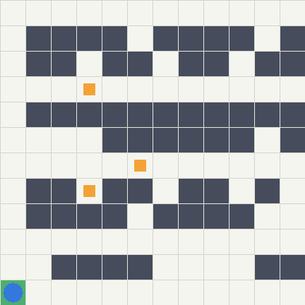
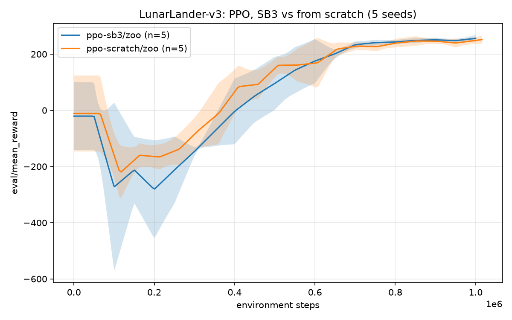
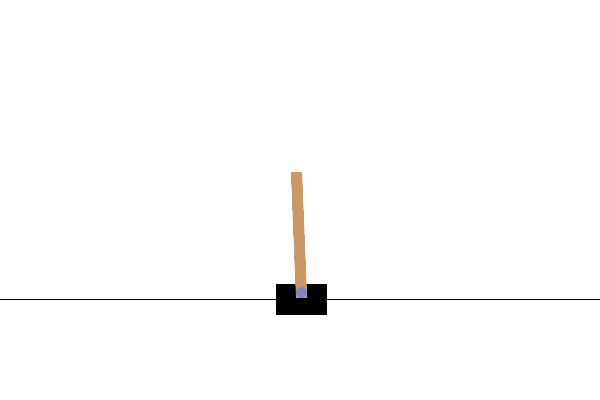
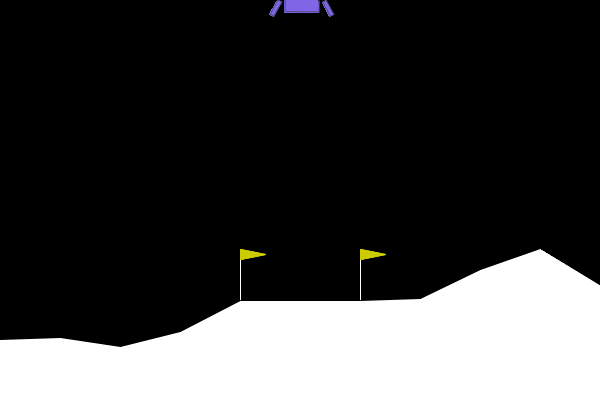
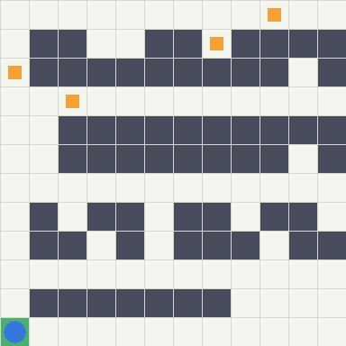

# RLProject

A config-driven reinforcement learning system: Stable Baselines3 and from-scratch DQN/PPO on Gymnasium benchmarks, with a custom **Warehouse robot** environment as the headline problem. A robot picks items from shelves and delivers them to a packing station on procedurally generated layouts, and the trained agent is evaluated on layouts it has never seen.



## Results at a glance

Held-out 12x12 layouts with 3 items, final policy, 100 episodes per seed. Efficiency is the optimal planner's step count divided by the agent's (0 for a failed episode).

| Agent | Success | Efficiency |
|---|---|---|
| Random | 0% | 0.00 |
| Greedy (nearest item) | 100% | 0.89 |
| **MaskablePPO + grid CNN + PBRS + curriculum** (5 seeds, 5M steps) | 99-100% | **0.93** (IQM, 95% CI [0.92, 0.96]) |
| Optimal planner | 100% | 1.00 |

What the experiments showed (3 seeds per ablation at 3M steps unless noted; full write-up with caveats in [docs/experiments.md](docs/experiments.md)):

- **Action masking is essential.** Plain PPO and DQN that merely penalise invalid actions both scored 0% success on every seed.
- **The curriculum matters.** Without it: 57% success and 0.39 efficiency, against 99% and 0.78.
- **Reward shaping matters little** once masking and the curriculum are in, and the hackable "naive" shaping caused no hacking at its default bonus.
- **Reward hacking is real at a larger bonus.** With a 10x bonus both agents deliver nothing and farm the shaping reward instead (return about +150, 0% success): see the [GIF](docs/figures/warehouse_reward_hacking.gif).
- **10 training layouts leave a generalisation gap; 100 close it.**
- **Tuned hyperparameters** (Optuna) beat the defaults by a wide margin on a small, short-budget problem (99% vs 12% success), but were not validated on the headline setting.

## Repository layout

```
configs/        YAML configs: benchmarks/, warehouse/, experiments/ (matrices), sweeps/ (Optuna)
src/rlagent/    envs/ (Warehouse-v0), agents/ (SB3 factory, scratch DQN/PPO, baselines),
                training/, evaluation/ (evaluate, aggregate, record), cli.py
dashboard/      Streamlit app (works without runs/)
models/         curated trained models, each with a short model card
results/        committed tables and figures (Phase 1-5, tuning)
docs/           env_spec.md (the environment), experiments.md (lab notebook), figures/
tests/          fast tests (CI) and slow learning tests
runs/           training output, gitignored
```

## Setup

Requires Python 3.11+ and [uv](https://docs.astral.sh/uv/).

```bash
uv sync                 # installs CUDA 12.8 PyTorch on Windows
uv sync --extra box2d   # adds Box2D for LunarLander
```

## Usage

```bash
# Train from a YAML config; any field can be overridden with --set
uv run rlagent train configs/benchmarks/cartpole_ppo.yaml --seed 0
uv run rlagent train configs/benchmarks/cartpole_dqn.yaml --set train.total_timesteps=20000

# Evaluate and record a finished run
uv run rlagent evaluate runs/CartPole-v1/ppo-sb3/zoo/seed_0 --episodes 100
uv run rlagent record runs/CartPole-v1/ppo-sb3/zoo/seed_0 --out docs/figures/cartpole_ppo.gif

# Overlay learning curves across seeds and compare implementations
uv run rlagent compare runs/CartPole-v1/ppo-sb3/zoo runs/CartPole-v1/ppo-scratch/zoo --out results/cartpole_ppo

# Watch learning curves, or live progress bars in the terminal
uv run tensorboard --logdir runs
uv run rlagent watch runs

# Experiment matrix (Phase 5): plan, run, aggregate; Optuna sweep; throughput benchmark
uv run rlagent matrix configs/experiments/phase5.yaml --dry-run
uv run rlagent aggregate configs/experiments/phase5.yaml
uv run rlagent tune configs/sweeps/ppo_warehouse.yaml --workers 4
uv run rlagent bench --workers 1,4
```

Each run writes to `runs/<env>/<algo>-<impl>/<name>/seed_<k>/` with the resolved `config.yaml`, `progress.csv`, TensorBoard logs, and the best and final models (with `VecNormalize` statistics when used).

## From-scratch agents (Phase 2)

`rlagent.agents.scratch` holds PPO and DQN written directly in PyTorch (discrete actions, flat observations). They plug into the same `train` / `evaluate` / `record` / `compare` commands as SB3 and log the same metric names, so curves overlay directly. Select them with `impl: scratch` in a config (see `configs/benchmarks/*_scratch.yaml`).

- **PPO:** clipped surrogate, GAE, orthogonal init, per-minibatch advantage normalisation, gradient clipping, LR annealing, KL early stop, time-limit bootstrapping.
- **DQN:** target network, Huber loss, gradient clipping, optional Double DQN (on by default, so it differs slightly from SB3's vanilla DQN), time-limit truncations stored as non-terminal.

## Benchmark results (Phases 1-2)

Hyperparameters start from the RL Baselines3 Zoo and are identical for SB3 and scratch. Scores are the **best checkpoint** (chosen by periodic 10-episode evals), re-evaluated on 100 fresh episodes with deterministic actions, then summarised over 5 seeds. IQM is the interquartile mean.

| Env | Algo | SB3 mean ± std (IQM) | Scratch mean ± std (IQM) |
|---|---|---|---|
| CartPole-v1 | PPO (100k steps) | 500.0 ± 0.1 (500.0) | 499.9 ± 0.3 (500.0) |
| CartPole-v1 | DQN (50k steps) | 497.0 ± 6.0 (500.0) | 499.9 ± 0.1 (500.0) |
| LunarLander-v3 | PPO (1M steps) | 254.2 ± 6.1 (255.9) | 250.1 ± 7.4 (250.6) |

LunarLander is considered solved at 200. Scratch PPO is within about 2% of SB3 on LunarLander (IQM 250.6 vs 255.9).

**Caveat on DQN.** Both DQN implementations are unstable on CartPole. Mean eval return swings between roughly 150 and 450 during training and is only about 240 (SB3) and 350 (scratch) at the final step, so the near-perfect scores above reflect best-checkpoint selection, not final-policy quality. PPO is stable. Aggregated statistics and DQN stabilisation experiments come in Phase 5.

Curves and tables: `results/cartpole_ppo_*`, `results/cartpole_dqn_*`, `results/lunarlander_ppo_*`.



| CartPole PPO | LunarLander PPO |
|---|---|
|  |  |

## Warehouse-v0 (Phase 3)

A custom environment: a robot picks items from shelf-side cells and delivers them to a packing station, with procedurally generated layouts, train/test layout splits, vector and grid observations, configurable reward shaping (including a deliberately hackable `naive` mode), and an exact optimal planner for the efficiency metric. Full spec: [docs/env_spec.md](docs/env_spec.md).



Reference agents on held-out layouts (200 episodes; efficiency = optimal steps / agent steps):

| Setting | Random | Greedy | Optimal |
|---|---|---|---|
| small (8x8, 2 items, capacity 2) | 0.5% success | 100% / eff 1.00 | 100% / eff 1.00 |
| medium (12x12, 3 items, capacity 2) | 0% success | 100% / eff 0.89 | 100% / eff 1.00 |
| hard (16x16, 5 items, capacity 3) | 0% success | 100% / eff 0.91 | 100% / eff 1.00 |

```bash
uv run rlagent baseline configs/warehouse/ppo_vector.yaml --agent greedy --episodes 100 \
  --set env.kwargs.n_items=5 --set env.kwargs.capacity=3 --set env.kwargs.split=test
```

## Warehouse agent (Phase 4)

**MaskablePPO + grid CNN + PBRS reward shaping + a 3-stage curriculum** solves held-out 12x12 layouts with 3 items (capacity 2). Final policy, 100 episodes on layouts never seen in training:

| Agent | Success | Efficiency (optimal steps / agent steps) |
|---|---|---|
| Random | 0% | 0.00 |
| Greedy (nearest item) | 100% | 0.89 |
| **PPO agent, seed 0** | 99% | 0.93 |
| **PPO agent, seed 1** | 100% | 0.95 |
| Optimal planner | 100% | 1.00 |


Three things made the difference: action masking (a penalty for invalid actions collapsed exploration), a whole-map grid observation with a small CNN (a local 7x7 patch was not enough to navigate), and a curriculum (0.76 to 0.89 success at 2M steps). Without shaping the agent still reaches 58-64% success but wastes most of its steps. The full log, including the failures, the held-out/selection caveats and the configuration sweep, is in [docs/experiments.md](docs/experiments.md). The table shows two seeds; the 5-seed confirmation is in the Phase 5 section below.

```bash
uv run rlagent train configs/warehouse/maskable_grid.yaml --seed 0      # about 2h45m on an RTX 5060
uv run rlagent evaluate runs/Warehouse-v0/maskable_ppo-sb3/maskable_grid/seed_0 --final \
  --set env.kwargs.split=test --tag test
```

Curated models: [models/warehouse-maskable-ppo/](models/warehouse-maskable-ppo/) (seed 1), the other four headline seeds in `models/warehouse-maskable-ppo-seed{0,2,3,4}/`, and the deliberately hacked agent in [models/warehouse-naive-hacking/](models/warehouse-naive-hacking/).

## Experiments (Phase 5)

**Five seeds of the final agent** (5M steps, held-out 12x12 layouts, final policy, 100 episodes each): success 99 / 100 / 100 / 99 / 100%, efficiency 0.927 / 0.947 / 0.961 / 0.916 / 0.921 (IQM 0.93, 95% CI [0.92, 0.96]), against 0.89 for the greedy planner. Seeds 2-4 were not used to choose the configuration.

Ablations at 3M steps (3 seeds each unless noted; 3-seed intervals understate the uncertainty):

| Question | Result |
|---|---|
| Does reward shaping matter? | Little, once the curriculum and masking are in: sparse 0.81, naive 0.83, PBRS 0.78 efficiency, all about 99-100% success |
| Does the hackable "naive" shaping cause reward hacking? | Not at the default bonus (0.1). At 1.0 both seeds hack: 0% success, nothing delivered, return about +150 ([GIF](docs/figures/warehouse_reward_hacking.gif)) |
| Mask or penalise invalid actions? | Masking is essential: plain PPO with a penalty never learned to move (0% success, 3/3 seeds) |
| PPO vs DQN? | Not decidable here: DQN with a penalty and no masking also gets 0% success (3/3 seeds), like penalty-only PPO |
| Observation design | Whole-map grid + CNN: ~99% success; local-patch vector + MLP: 24% (network and observation changed together) |
| How many training layouts? | 10 layouts: 94% held-out success with a train/held-out gap; 100 layouts: no measurable gap |
| Curriculum on vs off | Off: 57% success, 0.39 efficiency (3 seeds) vs 99% / 0.78 with it, at 3M steps |

**Hyperparameter sweep:** 27 Optuna trials (10x10, 2 items, no curriculum, 1M steps). On fresh seeds the best configuration reaches 99% held-out success and 0.87 efficiency there, against 12% and 0.09 for the default hyperparameters. It was not tested on the headline 12x12 setting (where the defaults already reach 0.93 with the curriculum at 5M steps), and no headline result uses it. **Not done:** that test and the 16x16 setting. Details, caveats and per-run numbers: [docs/experiments.md](docs/experiments.md) and `results/phase5_summary.md`, `results/tuning_check_summary.md`.

## Dashboard (Phase 6)

```bash
uv run streamlit run dashboard/Overview.py
```

Five pages: **Watch Agent** (step through an episode with the policy's action probabilities), **Learning Curves** (mean and 95% CI across seeds), **Compare Agents** (RL vs greedy vs optimal vs random, IQM with bootstrap intervals), **Reward Lab** (the shaping ablation, a scripted reward-hacking demo and a replay of the large-bonus agent) and **Sandbox** (generate a layout, run baselines and the curated model on it, or drive the robot yourself).

It works from a fresh clone with no `runs/` folder: it reads the committed `models/`, `results/` and `docs/figures/`, and uses `runs/` only when present (discovered lazily, one metric at a time). Inference runs on CPU. To point it elsewhere, set `RLAGENT_RUNS_ROOT`, `RLAGENT_MODELS_ROOT` or `RLAGENT_RESULTS_ROOT`.

## Design decisions

- **One run-directory contract.** Every run, SB3 or scratch, writes the same files to `runs/<env>/<algo>-<impl>/<name>/seed_<k>/` (resolved config, `progress.csv`, TensorBoard logs, models, `metadata.json`), and the scratch agents log SB3's metric names. The evaluator, comparison tools and dashboard never need to know which implementation produced a run.
- **Final policy, not best checkpoint.** Best-checkpoint scores overstate quality (the CartPole DQN caveat above), so the Warehouse results use the final model, evaluated on held-out layouts that no selection step saw.
- **Held-out layouts and an exact baseline.** Layouts are split into train and test pools, and an optimal planner defines the efficiency metric, so "success" cannot hide a wasteful policy.
- **Potential-based shaping.** PBRS leaves the optimal policy unchanged; the deliberately hackable `naive` mode exists to show what happens when shaping is not potential-based.
- **Statistics.** Interquartile mean with a percentile-bootstrap interval over seeds, implemented in `evaluation/aggregate.py`. With 3 seeds the interval is close to the min-max range, so it understates the uncertainty, and the docs say so wherever it applies.
- **Resumable experiment matrix.** `rlagent matrix` skips finished jobs, so an interrupted batch (this machine was restarted by Windows Update mid-run once) picks up where it left off.

## Limitations

- One environment family, one grid size for the headline, and only the PPO family solves it. DQN was run once, untuned and without masking, so the PPO-vs-DQN comparison is inconclusive rather than a ranking.
- Ablations use 3 seeds and a 3M-step budget, which is not the 5M-step headline budget; budget alone moves efficiency from 0.78 to 0.93.
- The observation ablation changed the network as well as the observation. The tuned hyperparameters were validated only on the small sweep problem.
- The 16x16 / 5-item setting and from-scratch PPO on the warehouse were not run. The dashboard was checked page by page in headless Chrome (Playwright) but has no automated browser test in CI.

## Reproducing the headline result

```bash
uv sync
uv run rlagent matrix configs/experiments/phase5.yaml --only headline --dry-run   # plan and time estimate
uv run rlagent matrix configs/experiments/phase5.yaml --only headline             # 5 seeds x 5M steps, then evaluates
uv run rlagent aggregate configs/experiments/phase5.yaml                          # tables and figures in results/
```

A 5M-step run takes roughly 2-3 hours on an RTX 5060 laptop GPU (CUDA 12.8 PyTorch). The full Phase 5 matrix plus the DQN arm and the Optuna sweep took about two nights on four parallel workers.

## License

MIT, see [LICENSE](LICENSE).

## Project phases

| Phase | Scope | State |
|---|---|---|
| 0 | Scaffold, tooling, CI | Done |
| 1 | SB3 benchmark pipeline (train / evaluate / record) | Done |
| 2 | From-scratch DQN and PPO | Done |
| 3 | Warehouse-v0 environment and baselines | Done |
| 4 | Warehouse training and reward engineering | Done (target met) |
| 5 | Experiments, tuning, statistics | Done |
| 6 | Streamlit dashboard | Done |
| 7 | Polish | Done (models, model cards, README; dashboard checked in a real browser with Playwright) |

## Development

```bash
uv run ruff check . && uv run ruff format --check .
uv run pytest -m "not slow"
```
